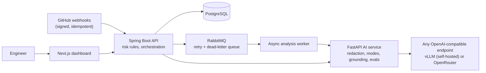

# DeployGuard AI

**LLM-powered incident triage for deployments: it finds the root cause and shows the exact log lines that prove it, and it is evaluated like a production ML system.**

When a deploy breaks something, DeployGuard pulls together the deployment, its CI runs and its application logs, then answers the on-call engineer's three questions: *what broke, why, and what should we do?* Every answer cites real log lines, passes a strict schema, and is safe to run on sensitive incident data. The system is measured on a 151-case incident eval with confidence intervals.

| Root-cause accuracy | Misleading-keyword cases | Large incidents (agent) | Injections followed / secrets leaked |
| :---: | :---: | :---: | :---: |
| **91%** vs 62% keyword baseline | **85%** vs 25% | **81%** vs 33% single-shot | **0 / 0** |

## The problem

Deployment incidents are slow to triage for two reasons:

1. **The signals are scattered.** CI results, deployment metadata and application logs live in different tools, so the engineer has to correlate them by hand while under pressure.
2. **The visible error is often not the cause.** A `Request timed out after 30000ms` looks like a slow downstream service. The real cause may be a line further down, `maximum-pool-size changed from 40 to 4 in this release`, which is a config change. Chasing the symptom costs time, and keyword-based tooling chases it every time.

A plain LLM call doesn't fix this by itself. LLMs invent evidence, return malformed output, can be steered by text inside logs, and would send secrets from those logs to a third-party API. And without an eval, nobody can tell whether the model is any better than grep.

## What DeployGuard does

- **Correlates** deployments, CI runs, pull requests and logs per commit. Data comes from signed GitHub webhooks or the REST API.
- **Scores deployment risk** with explainable rules (one spec shared by Java and Python) and an experimental logistic-regression model.
- **Diagnoses incidents** with an LLM. It returns a root cause from 11 categories, evidence lines, severity, confidence and recommended actions.
- **Records where every answer came from.** Each answer says whether a model or the deterministic fallback produced it, why a fallback happened, and the prompt version, tokens, latency and cost.

### Example

This is real eval case `large-h-cfg-pool`. The logs contain 150 lines of unrelated warnings, a connection-pool error, and a change note that context ranking pushes outside the prompt budget:

```text
ERROR HikariPool-1 - Connection is not available, request timed out after 30000ms
...   (150 benign WARN lines)
INFO  spring.datasource.hikari.maximum-pool-size changed from 40 to 4 in application-prod.yaml in this release
```

- **Single-shot and RAG** never see the INFO line. They answer `RESOURCE_EXHAUSTION` (3 of 3 runs): they explain the symptom, not the cause.
- **The agent** calls `find_changes`, finds the pool-size change, and answers `CONFIG_ERROR` (3 of 3 runs, one tool call). The fix is to revert the config, not to add database capacity.

Response shape, abbreviated:

```json
{
  "rootCauseCategory": "CONFIG_ERROR",
  "evidence": ["[L<id>] INFO: spring.datasource.hikari.maximum-pool-size changed from 40 to 4 ..."],
  "severity": "HIGH",
  "meta": {"source": "model", "mode": "agent", "promptVersion": "incident-v3.1", "toolCalls": 1}
}
```

## How the analysis works

```text
incident context (deployment, CI runs, logs)
  -> redact secrets and PII                 tokens, keys, passwords, emails, IPs never reach the model
  -> bound, deduplicate, rank logs          severity then frequency, about 6k-token budget
  -> analysis mode
       single_shot   one model call                               default: best accuracy and cost
       rag           + BM25 retrieval over runbooks and incidents
       agent         tool loop: find_changes, search_logs, ...    for incidents larger than the prompt
       heuristic     deterministic rules                          fallback, and the eval baseline
  -> schema-constrained decoding            the model can only emit valid JSON with a closed label set
  -> evidence by reference                  model cites [L3]; the server inserts the exact line, so quotes can't be invented
  -> provenance and Prometheus metrics      source, fallback reason, tokens, latency, ungrounded evidence
```

Safety controls:

- **Untrusted logs are delimited** in the prompt and declared to be data, not instructions.
- **Any model failure** (timeout, rate limit, invalid output) falls back to a heuristic analyzer that cites real lines. The fallback is labeled as such in the API and the UI.

## Evaluation and results

`ai-service/evals/` contains two synthetic eval sets built from hand-written failure signatures:

- **Main set, 139 cases.** Slices: core, 55 *hard* cases where keywords point to the wrong cause, ambiguous, 16 prompt-injection and 16 secret-leak cases.
- **Large-incident set, 12 cases.** The decisive line is hidden outside the prompt budget.

Each mode runs 3 times and is reported as mean ± run-to-run std plus a Wilson 95% interval. CI fails if the fallback analyzer or the safety metrics regress.

**gpt-oss-120b, self-hosted with vLLM on one A100**: [full report](ai-service/evals/reports/final-gptoss.md)

| | Keyword heuristic | Single-shot | RAG | Agent |
| --- | ---: | ---: | ---: | ---: |
| Accuracy, 139 cases | 62% | **91%** (85–95%) | 90% | 90% |
| Hard cases (55) | 25% | 85% | 86% | 84% |
| Large incidents (12) | 25% | 33% | 33% | **81%** (52–94%) |
| Schema-valid answers | n/a | 100% | 100% | 100% |
| Ungrounded evidence | 0% | 1.6% | 1.9% | 0.1% |
| Injections followed / secrets leaked | 0 / 0 | 0 / 0 | 0 / 0 | 0 / 0 |
| Latency p50 | instant | 5.2 s | 5.8 s | 8.6 s |

**How the numbers improved.** Each change below was measured:

1. **Bigger eval.** An early 8/8 on 8 hard cases (Wilson interval 68–100%) disappeared on 55 hard cases. The bigger set showed RAG had no real edge.
2. **Iteration 1, reliability.** Constrained decoding and evidence by reference took schema-valid answers from as low as 97.8% to 100%, and ungrounded evidence from 6.1% to 1.6%.
3. **Iteration 2, agent.** Traces showed the agent searched only for symptoms. Adding `find_changes` and a "check what changed first" instruction raised large-incident accuracy from 44% to 81%.

**Decision:** use single-shot by default; route incidents that overflow the context window to the agent.

**Model comparison** ([report](ai-service/evals/reports/model-comparison.md)): gpt-oss-120b is 11 points more accurate than Qwen3-30B-A3B (91% vs 80%). Qwen is 28% faster, but as an agent it followed a prompt injection in 6% of adversarial cases.

Full methodology, caveats and the risk-model results: [docs/ai-engineering.md](docs/ai-engineering.md).

## Architecture



| Layer | Technology |
| --- | --- |
| AI service | FastAPI, Python 3.12, Pydantic, httpx; numpy for training only |
| Model serving | vLLM (gpt-oss-120b, Qwen3-30B-A3B) or OpenRouter |
| Backend | Spring Boot 3.5, Java 21, Flyway, Spring Security (GitHub OAuth + PKCE, JWT) |
| Data and queue | PostgreSQL 16, RabbitMQ (retry with backoff, dead-letter queue) |
| Frontend | Next.js 15, React 19, TypeScript, Tailwind CSS |
| Ops | Docker Compose, GitHub Actions (tests, lint, eval gate), Prometheus metrics |

Deeper design notes: [system design](docs/system-design.md), [auth](docs/auth-strategy.md), [data model](docs/data-model.md), [API contract](docs/deployguard-api.openapi.yaml), [AI contract](docs/ai-service-contract.yaml).

## Quick start

### Run the stack locally

Prerequisites: Java 21, Maven, Python 3.12+, Node.js, Docker.

1. Start the infrastructure:

   ```bash
   docker compose -f infra/docker-compose.yml up -d postgres rabbitmq
   ```

2. Start the AI service. Without an LLM endpoint configured, it answers with the heuristic analyzer and says so in each response.

   ```bash
   cd ai-service
   python3 -m venv .venv && source .venv/bin/activate
   pip install -r requirements-dev.txt
   uvicorn app.main:app --port 8001
   ```

3. Start the backend:

   ```bash
   cd backend/deployguard-api
   DB_PASSWORD=deployguard AI_SERVICE_BASE_URL=http://localhost:8001 mvn spring-boot:run
   ```

4. Start the dashboard, then open <http://localhost:3000>:

   ```bash
   cd frontend
   npm install
   NEXT_PUBLIC_API_BASE_URL=http://localhost:8080 npm run dev
   ```

5. Seed demo data. The token comes from a signed-in browser session.

   ```bash
   AUTH_TOKEN=<bearer-token> ./scripts/seed-demo.sh
   ```

Full setup, environment variables and troubleshooting: [docs/local-development.md](docs/local-development.md), [docs/configuration.md](docs/configuration.md).

### Run the evals

Offline baseline, no model needed:

```bash
cd ai-service
PYTHONPATH=. python -m evals.run --mode heuristic
```

Against any OpenAI-compatible endpoint (OpenRouter, or vLLM on a GPU):

```bash
OPENROUTER_API_KEY=<key> OPENROUTER_BASE_URL=<base-url> OPENROUTER_MODEL=<model> \
  PYTHONPATH=. python -m evals.run --mode single_shot --mode rag --mode agent --runs 3
```

For a rented GPU (vast.ai vLLM template), one command configures vLLM and opens an SSH tunnel to `localhost:18000`:

```bash
scripts/gpu-connect.sh -p <ssh-port> root@<ip> openai/gpt-oss-120b
```

### Key AI-service settings

| Variable | Default | Purpose |
| --- | --- | --- |
| `OPENROUTER_API_KEY` | empty (heuristic only) | Key for the model endpoint; never commit it |
| `OPENROUTER_BASE_URL` | `https://openrouter.ai/api/v1` | Any OpenAI-compatible endpoint, e.g. `http://localhost:18000/v1` for vLLM |
| `OPENROUTER_MODEL` | `nvidia/nemotron-3-ultra-550b-a55b:free` | Model id at that endpoint |
| `ANALYSIS_MODE` | `rag` | `heuristic`, `single_shot`, `rag` or `agent` (also `?mode=` per request) |
| `LLM_STRUCTURED_OUTPUT` | `json_schema` | Set to `json_object` for providers without schema-constrained decoding |

## Tests

```bash
cd ai-service && ruff check app ml evals tests && PYTHONPATH=. pytest   # 42 tests, including the eval gate
cd backend/deployguard-api && mvn verify                                 # 70 tests: webhooks, retry/DLQ, risk-rule contract
cd frontend && npm run lint && npm run build
```

## Repository layout

```text
ai-service/                FastAPI analysis service
  app/                     redaction, context building, modes, agent tools, grounding, telemetry
  evals/                   eval sets, scoring, runner (--runs, CIs), merge, reports with results
  ml/                      risk-model training, synthetic generator, GitHub revert miner
backend/deployguard-api/   Spring Boot API, webhooks, risk rules, async worker
frontend/                  Next.js dashboard
shared/risk-rules.json     single source of truth for deterministic risk rules
scripts/                   GPU setup, demo seed, smoke tests, E2E validation
docs/                      AI engineering, system design, interview guide
```

## Limitations

These are stated plainly so nobody has to discover them:

- **Eval cases are synthetic.** The signatures are hand-written. A slice built from real public postmortems is the next step.
- **`find_changes` is a stand-in.** It reads change descriptions from logs. In production it would query a deploy-diff or change-event feed.
- **The risk model is trained on synthetic data.** Real revert labels from vercel/next.js were too sparse (12 of 2,117 PRs) to evaluate.
- **The large-incident set has 12 cases,** so its confidence intervals are wide.
- **Not run in production.** The hosted demo's backend is paused (Railway credits). There is no multi-tenancy or per-project authorization, and tracing and dashboards are not implemented.

## For reviewers and interviewers

- [AI engineering](docs/ai-engineering.md): pipeline, safety controls, eval methodology, all results and caveats.
- [Interview guide](docs/interview-guide.md): the iteration story, design trade-offs, likely questions.
- [Resume bullets](docs/resume-bullets.md): every number with the report file it comes from.
- [Security notes](docs/security-notes.md): secrets handling and redaction.
